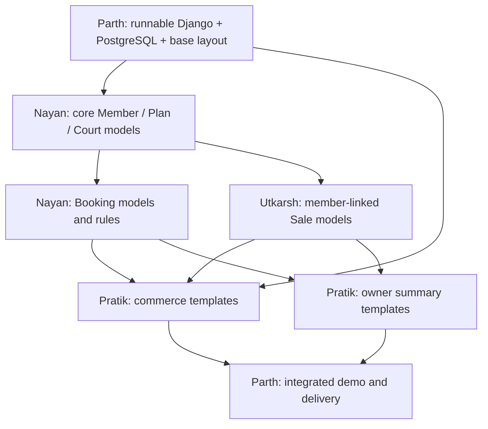

[Champions_Club_Team_Contract.md](https://github.com/user-attachments/files/35204881/Champions_Club_Team_Contract.md)
# Champions Club - team roles and integration contract

## Working architecture

Use one Django codebase with Django templates, HTMX, and Alpine for small interactions. Use PostgreSQL 16 in the shared Docker Compose setup. Use Tailwind only if it is already working in the repository. Do not add a separate React app, Supabase project, or API server for this MVP.

Set the Django timezone to `Asia/Kolkata`. Use decimal fields for money. Keep secrets in local environment files; commit only an `.env.example` with variable names and safe placeholders.

## Shared data contract

| Record | Owner | Fields and rules other teammates rely on |
|---|---|---|
| `MembershipPlan` | Nayan | `id`, `tier` (`gold`, `silver`, `junior`), court price/entitlement, shop discount, bar discount, active flag. Keep the three demo plans simple. |
| `Member` | Nayan | `id`, name, contact details, `plan_id`, membership start/end dates, optional suspended flag. Use this one record for bookings and sales. Derive expired status from dates. |
| `Court` | Nayan | `id`, name, sport, capacity, active flag. |
| `Booking` | Nayan | `id`, optional `booked_by_member_id` for a walk-in, `court_id`, start/end, status (`draft`, `confirmed`, `cancelled`), type (`standard`, `social`), price snapshot, currency. |
| `BookingParticipant` | Nayan | `booking_id`, optional `member_id`, guest name if needed. Every playing member is represented once; this is how the two-plays-per-day rule counts social play. |
| `Product` | Utkarsh | `id`, name, category (`shop`, `bar`), price, stock quantity, low-stock threshold, active flag. |
| `Sale` | Utkarsh | `id`, optional `member_id`, status (`draft`, `completed`, `cancelled`), payment method (`cash`, `card`, `UPI`), subtotal, discount, total, created time. Use Nayan's `Member`; never create a second customer list. |
| `SaleItem` | Utkarsh | `sale_id`, `product_id`, quantity, unit-price snapshot, discount, line total. |
| `Enquiry` | Utkarsh | Visitor name/contact, request/message, status, created time; link to `Member` if converted. Stretch goal after core flow. |

### Rules all features must follow

- Sessions are 60 minutes and start every 30 minutes.
- A confirmed booking blocks the same court for its full time range. Enforce no-overlap in PostgreSQL with a GiST exclusion constraint and `btree_gist`; the screen's availability check is only a convenience.
- A member can participate in at most two confirmed bookings per club-local date. Count each member once per booking, including social bookings. Guests without a member record do not count against a member's limit.
- Store the booking price and sale item price/discount when confirmed/completed; later plan changes must not rewrite history.
- Membership status and booking pricing rule: A member receives their plan's court rate only when their membership dates include the booking date and they are not suspended. An expired or suspended profile may still be used to book at the normal walk-in court rate (retaining the member link for club history, but without member pricing or plan benefits). A booking without a member profile also uses the normal walk-in court rate. The booking form does not accept a user-submitted price; the backend calculates and snapshots it upon confirmation.
- Complete a sale and decrement stock in one database transaction, once only. Cancelled sales must not leave stock deducted.
- Owner summaries read booking and sale records; do not save manually typed totals. Label confirmed booking value separately from completed shop/bar sales.

## Role charters

### Nayan - Backend: membership and bookings

**Owns:** Django app `club` (or the agreed core app), models, forms/views, migrations, and backend rules for membership and court operations.

**Build order:**

1. Create `MembershipPlan`, `Member`, and `Court` with the fields above; migrate and give Parth a working member/court record.
2. Create `Booking` and `BookingParticipant`; expose named Django routes for the booking list/calendar, create, and cancel actions.
3. Enforce 60-minute sessions, 30-minute starts, price snapshots, the daily participation cap, and the PostgreSQL no-overlap constraint.
4. Give Pratik the exact template names, route names, form field names, and view context keys for member and booking pages.
5. Seed Gold, Silver, Junior, one member per tier, and a few courts with Parth.

**Done when:** a member can be created and booked; overlapping bookings and a third daily play are rejected; cancellation frees the slot.

### Utkarsh - Backend: shop and bar

**Owns:** Django app `commerce`, models, forms/views, migrations, and backend rules for products, stock, sales, and payments.

**Depends on:** Nayan's `Member` and `MembershipPlan` models for member-linked sales and tier discounts. Build `Product` and its catalog first if Nayan's migration is not ready; add the member link after the shared model is merged.

**Build order:**

1. Create `Product`, grouped into shop/bar categories, with price, stock, and low-stock threshold.
2. Create `Sale` and `SaleItem`, using a foreign key to Nayan's `Member` when the sale is for a member.
3. Add one counter-sale flow for guest and member purchases. Snapshot prices/discounts and apply the tier discount from the shared plan.
4. Make completing the sale and deducting stock atomic and idempotent; handle cancellation without double-restocking.
5. Expose named routes and hand Pratik the template names, route names, form fields, and context keys for products and sales.

**Done when:** one member sale records the right total, changes stock exactly once, and is visible to the owner summary.

### Pratik - Frontend

**Owns:** Django templates, shared page styling, HTMX/Alpine interactions, and responsive layouts. This is the frontend for the same Django app, not a separate React/Vite application.

**Build order:**

1. Agree with Parth on `base.html`, navigation labels, and a small style foundation. Use the agreed template folder structure.
2. Build member/booking templates from Nayan's route and context handoff.
3. Build product/sale templates from Utkarsh's route and context handoff.
4. Build the owner dashboard from the confirmed booking/sale summary context. Use simple cards, tables, and small CSS bars first; charts are stretch.
5. Add a public club page and enquiry form only after the staff flow works.

**Frontend contract:** templates may format and validate for usability, but prices, discounts, booking limits, overlap checks, and stock changes are decided by backend/database logic. Use named Django routes rather than hard-coded URLs.

**Done when:** the member-to-booking-to-sale-to-owner-summary flow can be completed through the shared UI without admin/database edits.

### Parth - Integration and delivery

**Owns:** repo startup, Django project settings, Docker Compose PostgreSQL setup, `.env.example`, root README run steps, shared base layout/navigation, migration order, seed/demo data, integration checkpoints, and final demo.

**Build order:**

1. Make the shared repo start with one documented command and confirm all four can run it.
2. Set up PostgreSQL 16 in the shared Compose file and ensure `btree_gist` is enabled for migrations.
3. Create the minimal Django project shell and shared `base.html`; leave feature models to Nayan and Utkarsh.
4. Ensure `commerce` migrations depend on the core migration that creates `Member`/`MembershipPlan`; resolve migration conflicts before they reach `main`.
5. Integrate small slices as soon as they work; keep `main` runnable and seed repeatable demo records.
6. Rehearse the full story and freeze feature scope near the end.

**Done when:** any teammate can clone, start, and seed the app; migrations apply in order; the end-to-end demo works from a clean database.

## Handoffs and dependency workflow

1. **Start together (first hour):** Parth commits the runnable project shell, one database setup, environment example, and run steps. Everyone clones and starts it. No feature work is considered integrated until it runs here.
2. **Core records (next):** Nayan defines and migrates `MembershipPlan`, `Member`, and `Court`. Parth confirms the migration is on the shared branch. Utkarsh can build the independent product catalog while waiting; Pratik can build the shared layout and static page shells.
3. **Backend handoffs:** Nayan publishes booking route/form/context names. After Nayan's core migration lands, Utkarsh adds the member link to `Sale`. Commerce migrations must depend on the core migration. Each backend owner shows one working record flow before adding edge cases.
4. **Frontend connection:** Pratik connects templates only after each backend owner shares its URL names, template path, context keys, and submitted field names. If the backend changes a field or route, its owner updates the contract and tells Pratik before merging.
5. **First vertical slice:** Nayan's member and booking work plus Pratik's templates must support create-member → book-court → reject-overlap. Then Utkarsh and Pratik connect a member sale → stock update → owner summary.
6. **Integration rhythm:** merge small changes after each checkpoint, not at the end. Parth keeps main runnable, coordinates migrations, and stops new work when a handoff breaks the demo path.
7. **Final hours:** stop stretch work; verify clean startup, seeded data, booking rejection, stock change, and dashboard figures; rehearse once end to end.

## Checkpoints

| Target | Checkpoint |
|---|---|
| Hour 1 | Everyone starts the same Django app and database. |
| Hour 4 | Member, plan, and court exist in the shared database. |
| Hour 8 | Booking UI works; overlap and daily cap are enforced. |
| Hour 12 | Member shop/bar sale completes and stock updates once. |
| Hour 16 | Owner summary reads booking and sale records. |
| Hour 19 | Feature freeze; rehearse and fix only demo blockers. |

If a checkpoint slips, cut stretch scope (social booking UI, online delivery, tabs, advanced charts) before weakening the shared data relationships or booking conflict rule.
